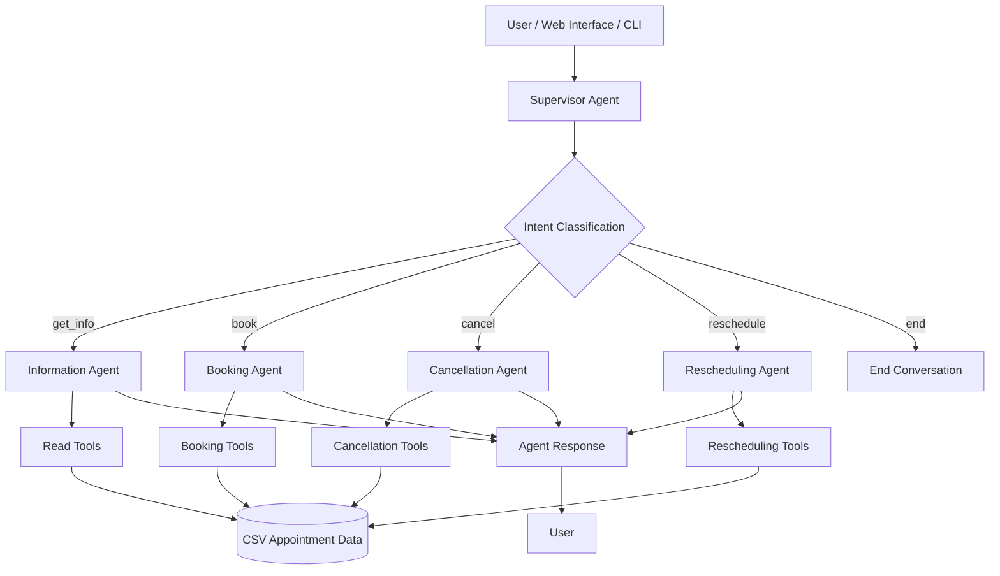

# 🦷 Dental Appointment Management System
### AI-Powered Multi-Agent Appointment Scheduling Using LangGraph & Groq

An intelligent dental appointment management system built with **Python, LangGraph, LangChain, and Groq**, designed to simplify dental clinic scheduling through natural language interactions.

The application uses a **supervisor-based multi-agent architecture** in which specialized AI agents collaborate to manage appointment availability, bookings, cancellations, and rescheduling.

Patients and clinic staff can interact with the system conversationally instead of navigating complex scheduling workflows.

## 📌 Project Overview

The Dental Appointment Management System demonstrates how **Agentic AI and Large Language Models (LLMs)** can automate real-world administrative workflows.

A central Supervisor Agent interprets user requests, identifies the intended action, and delegates execution to specialized agents.

The project combines AI-driven decision-making with structured appointment data management to create a modular, extensible scheduling solution.

### Key Highlights

- **Multi-Agent Architecture:** Dedicated AI agents handle individual appointment operations.
- **Natural Language Interaction:** Users communicate with the system using conversational requests.
- **Intelligent Intent Classification:** A supervisor routes requests to the appropriate agent.
- **Appointment Management:** Supports booking, cancellation, rescheduling, and availability checks.
- **LangGraph Orchestration:** Coordinates agent execution, conditional routing, and conversation state.
- **Groq LLM Integration:** Enables fast natural language understanding and agent responses.
- **CSV-Based Storage:** Uses Pandas for structured appointment data management.
- **Web and CLI Interfaces:** Supports both browser-based interaction and command-line execution.
- **Modular Architecture:** Separates agents, tools, workflows, configuration, and data operations.

---

## 🚀 Features

### 1. Appointment Availability
- Search available appointment slots.
- Filter appointments by dental specialization.
- Retrieve doctor information and schedules.
- View existing appointments using patient IDs.

### 2. Intelligent Appointment Booking
- Interpret natural language booking requests.
- Identify patient, doctor, date, and time.
- Check slot availability before booking.
- Update appointment records after successful booking.

### 3. Appointment Cancellation
- Identify existing patient appointments.
- Process cancellation requests.
- Release cancelled appointment slots for future bookings.
- Update appointment availability records.

### 4. Appointment Rescheduling
- Identify an existing appointment.
- Check availability for the requested new slot.
- Update appointment details.
- Maintain consistency in appointment records.

### 5. Multi-Agent Coordination
- Classify user intent through a Supervisor Agent.
- Route requests to specialized agents.
- Execute relevant tools.
- Return conversational responses.

---

## 🛠️ Technology Stack

| Category | Technologies |
|---|---|
| Programming Language | Python |
| AI Framework | LangChain |
| Agent Orchestration | LangGraph |
| LLM Provider | Groq API |
| Data Processing | Pandas |
| Data Validation | Pydantic |
| Backend API | FastAPI |
| API Server | Uvicorn |
| Frontend | JavaScript-based web interface |
| Data Storage | CSV |
| Configuration | Environment Variables |
| Development Tools | VS Code, Git, GitHub |

---

## 🧠 System Architecture

The application follows a **Supervisor-Based Multi-Agent Architecture**.

The Supervisor Agent acts as the central decision-making component and routes incoming user requests to the appropriate specialized agent.



### Agent Responsibilities

| Agent | Responsibility |
|---|---|
| Supervisor Agent | Analyzes user requests, classifies intent, and selects the next agent |
| Information Agent | Retrieves available slots, doctor schedules, and patient appointments |
| Booking Agent | Validates availability and creates appointment bookings |
| Cancellation Agent | Finds and cancels existing appointments |
| Rescheduling Agent | Checks alternative slots and updates existing appointments |

### How the Multi-Agent System Works

1. The user submits a request through the web interface or CLI.
2. The Supervisor Agent analyzes the request using an LLM.
3. The supervisor determines the request's intent.
4. LangGraph routes execution to the relevant specialized agent.
5. The agent invokes the appropriate tools to access or modify appointment data.
6. The system returns a natural language response to the user.

---

## 📂 Project Structure

```text
dental_agent_project/
│
├── main.py
│   └── Interactive CLI entry point
│
├── api.py
│   └── FastAPI backend entry point
│
├── doctor_availability.csv
│   └── Appointment and availability records
│
├── requirements.txt
│   └── Python dependencies
│
├── .env
│   └── API keys and environment configuration
│
├── dental_agent/
│   │
│   ├── agent.py
│   │   └── Main agent configuration
│   │
│   ├── config/
│   │   └── settings.py
│   │
│   ├── models/
│   │   └── state.py
│   │
│   ├── tools/
│   │   ├── csv_reader.py
│   │   └── csv_writer.py
│   │
│   ├── agents/
│   │   ├── supervisor.py
│   │   ├── info_agent.py
│   │   ├── booking_agent.py
│   │   ├── cancellation_agent.py
│   │   └── rescheduling_agent.py
│   │
│   └── workflows/
│       └── graph.py
│
└── frontend/
    └── Web application
```

---

## ⚙️ Installation and Setup

### Prerequisites

Before running the application, ensure you have:

- Python 3.10 or higher
- Node.js and npm for the frontend
- Git installed
- A valid Groq API key
- An internet connection for LLM API requests

### Step 1: Clone the Repository

```bash
git clone https://github.com/SIMRAN-KHAN14/dental-management-system-.git

cd dental-management-system-
```

### Step 2: Install Python Dependencies

```bash
pip install -r requirements.txt
```

### Step 3: Configure Environment Variables

Create a `.env` file in the project root directory.

```env
GROQ_API_KEY=your_groq_api_key_here
MODEL_NAME=llama-3.3-70b-versatile
TEMPERATURE=0
```

Obtain your API key from the [Groq Console](https://console.groq.com/).

**Security Note:** Never commit your `.env` file or API keys to GitHub. Add `.env` to your `.gitignore` file.

### Step 4: Start the Backend Server

Run the FastAPI application:

```bash
uvicorn api:app --reload --port 8000
```

The backend runs at:

```text
http://localhost:8000
```

FastAPI's interactive API documentation is available at:

```text
http://localhost:8000/docs
```

### Step 5: Start the Frontend

Open a new terminal and navigate to the frontend directory.

```bash
cd frontend
```

Install frontend dependencies:

```bash
npm install
```

Start the development server:

```bash
npm run dev
```

Open the application in your browser:

```text
http://localhost:5173
```

### Alternative: Run the CLI Application

The appointment management system can also be accessed through the command line.

```bash
python main.py
```

Enter appointment-related requests in natural language.

---

## 💬 Example Interactions

### Check Available Appointments

**User:**
> Show available appointments for an orthodontist.

**AI Assistant:**
```text
Here are the available orthodontist appointments:

1. 05/10/2026 - 09:00 AM - Dr. Emily Johnson
2. 05/10/2026 - 10:00 AM - Dr. Emily Johnson
3. 05/12/2026 - 02:00 PM - Dr. Emily Johnson

Please select your preferred appointment slot.
```

### Book an Appointment

**User:**
> Book an appointment for patient 1000082 with Dr. Emily Johnson on May 10 at 9 AM.

**AI Assistant:**
```text
Checking appointment availability...

The requested slot is available.

Appointment booked successfully!

Patient ID: 1000082
Doctor: Dr. Emily Johnson
Specialization: Orthodontist
Date: 05/10/2026
Time: 09:00 AM
```

### View Patient Appointments

**User:**
> Show all appointments for patient 1000048.

**AI Assistant:**
```text
Appointment found!

Patient ID: 1000048
Doctor: Dr. John Doe
Specialization: General Dentist
Date: 05/08/2026
Time: 09:00 AM
```

### Cancel an Appointment

**User:**
> Cancel patient 1000082's appointment on May 10 at 9 AM.

**AI Assistant:**
```text
Appointment cancelled successfully.

Patient ID: 1000082
Date: 05/10/2026
Time: 09:00 AM

The appointment slot is now available.
```

### Reschedule an Appointment

**User:**
> Reschedule patient 1000082's appointment from May 10 at 9 AM to May 12 at 10 AM.

**AI Assistant:**
```text
Checking the requested appointment slot...

The new slot is available.

Appointment rescheduled successfully!

Patient ID: 1000082
Doctor: Dr. Emily Johnson
New Date: 05/12/2026
New Time: 10:00 AM
```

*The examples above illustrate expected conversational behavior. Actual responses depend on appointment data and model output.*

---

## 🦷 Supported Dental Specializations

The application supports appointment management across multiple dental specialties:

- General Dentist
- Oral Surgeon
- Orthodontist
- Cosmetic Dentist
- Prosthodontist
- Pediatric Dentist
- Emergency Dentist

---

## 🗄️ Data Storage and Management

The system uses a CSV-based data storage mechanism to manage doctor availability and appointment records.

**File:** `doctor_availability.csv`

### Data Schema

| Column | Description |
|---|---|
| `date_slot` | Appointment date and time |
| `specialization` | Dental specialization |
| `doctor_name` | Name of the assigned dentist |
| `is_available` | Indicates whether the appointment slot is available |
| `patient_to_attend` | Patient ID associated with a booked appointment |

### Sample Data

```csv
date_slot,specialization,doctor_name,is_available,patient_to_attend
5/10/2026 9:00,orthodontist,Emily Johnson,True,
5/10/2026 10:00,orthodontist,Emily Johnson,False,1000048
5/12/2026 14:00,general_dentist,John Doe,True,
```

### Data Operations

**Read Operations**
- Retrieve available appointment slots.
- Search by specialization.
- Retrieve doctor schedules.
- Find appointments using patient IDs.

**Write Operations**
- Book appointments.
- Cancel existing bookings.
- Reschedule appointments.
- Update availability status.

The CSV storage layer provides a simple approach for demonstrating agent-based data operations. A production deployment would benefit from a transactional database to support concurrent bookings and stronger data integrity.

---

## 🔄 LangGraph Workflow

LangGraph coordinates communication between agents using a graph-based execution model.

### 1. Intent Classification

The Supervisor Agent identifies the user's intended action.

Supported intents:

```python
get_info
book
cancel
reschedule
end
```

A structured routing decision may contain:

```json
{
  "intent": "book",
  "next_agent": "booking_agent",
  "reasoning": "The user requested a new appointment."
}
```

### 2. Agent Selection

The supervisor routes execution to the agent responsible for the identified task.

For example:

```text
User Request
     |
     v
Supervisor Agent
     |
     v
Intent: book
     |
     v
Booking Agent
     |
     v
Availability Check
     |
     v
Appointment Update
     |
     v
Confirmation Response
```

### 3. Tool Execution

Each specialized agent uses task-specific tools.

For example:

- Information Agent → Read-only query tools
- Booking Agent → Appointment creation tools
- Cancellation Agent → Cancellation tools
- Rescheduling Agent → Appointment modification tools

This separation promotes modularity and controlled access to appointment operations.

### 4. State Management

LangGraph supports maintaining shared workflow state throughout agent execution.

Relevant state information includes:

- Conversation history
- Current user intent
- Selected agent
- Appointment parameters
- Tool execution results
- Generated responses

### 5. Response Generation

After the required operations are completed, the system generates a conversational response describing the result.

---

## 📚 Key Concepts Demonstrated

This project explores several important concepts in modern AI application development.

### Agentic AI

Specialized agents independently handle different categories of tasks within a coordinated workflow.

### Multi-Agent Orchestration

LangGraph manages communication, state transitions, and conditional routing between agents.

### LLM-Powered Intent Recognition

A language model interprets natural language requests and converts them into actionable instructions.

### Tool Calling

AI agents interact with Python functions to retrieve and modify structured data.

### Structured Data Validation

Pydantic supports typed data structures and validation within the application.

### Modular Software Architecture

Separating business logic, agent orchestration, tools, and configuration improves maintainability and extensibility.

### Natural Language Interfaces

Users can perform structured operations without learning complex commands or navigation patterns.

---

## 🔐 Security and Reliability Considerations

The current project is designed primarily as an educational demonstration of multi-agent appointment management.

For real-world clinical deployment, additional safeguards would be necessary:

- Authentication and role-based authorization.
- Patient identity verification before appointment changes.
- Protection of patient information and API credentials.
- Database transactions to prevent double bookings.
- Input validation and secure error handling.
- Audit logging for appointment modifications.
- Monitoring and testing of LLM-generated tool calls.

The application should not be used to manage real patient information without appropriate security, privacy, and operational controls.

---

## 🔮 Future Enhancements

Potential improvements include:

- **Database Integration:** Replace CSV storage with PostgreSQL or MongoDB.
- **User Authentication:** Add secure patient and clinic staff accounts.
- **Automated Reminders:** Send appointment notifications through email or SMS.
- **Calendar Integration:** Synchronize bookings with external calendars.
- **Doctor Dashboard:** Provide a dedicated interface for schedule management.
- **Appointment History:** Maintain detailed records of booking changes.
- **Conversational Memory:** Improve multi-turn appointment interactions.
- **Analytics Dashboard:** Visualize booking trends and appointment availability.
- **Deployment:** Host the frontend and backend on cloud infrastructure.
- **Automated Testing:** Add unit, integration, and agent workflow tests.

---

## 🎯 Project Objectives

The primary objectives of this project are to:

1. Develop a modular AI-powered appointment scheduling system.
2. Implement supervisor-based multi-agent orchestration using LangGraph.
3. Integrate LLMs with real-world data management tools.
4. Enable natural language interaction for appointment operations.
5. Demonstrate practical applications of Agentic AI in administrative automation.

---

## 👩‍💻 Author

**Simran Khan**

AI/ML | Python Development | Generative AI | Agentic AI

- **GitHub:** [SIMRAN-KHAN14](https://github.com/SIMRAN-KHAN14)
- **LinkedIn:** [Simran Khan](https://www.linkedin.com/in/simran-khan-013549212/)

---

## ⭐ Support

If you find this project useful, consider giving the repository a star.

**Built with Python, LangGraph, LangChain, and Groq to explore intelligent multi-agent workflow automation.**

